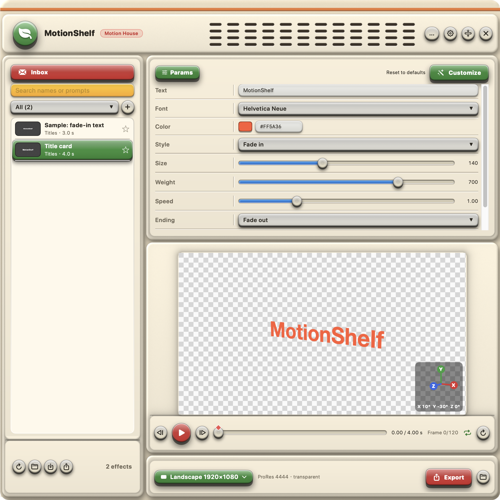

# MotionShelf

[繁體中文](README.zh-TW.md)

A floating macOS shelf for motion-graphics effects. Each effect is a small HTML animation with adjustable params; MotionShelf previews it and exports it as a **ProRes 4444 clip with a transparent background**, ready to drop onto a DaVinci Resolve (or Final Cut, Premiere, After Effects) timeline.

Collect motion prompts you find online, and let **Claude Code** turn them into effects for you.



## Features

- **Floating panel**: press ⌥Space to show or hide it over any app; shrink it to a one-line toolbar.
- **Params**: every effect exposes its own controls (text, fonts, colors, sliders, menus), and the preview updates live.
- **Transparent export**: ProRes 4444 with alpha in 1920×1080, 1080×1920 or 1440×1440. Drag the finished clip straight from MotionShelf into your editor.
- **Inbox**: paste a motion prompt and save it. Claude can first tell you how many separate effects the prompt contains.
- **Generate All**: Claude Code builds every inbox item into effects in the background, checks them and adds them to the list. A chat box shows its progress and lets you reply.
- **Customize**: ask Claude to add a param or change the motion of the selected effect, right from the params panel.
- **3D camera**: drag the preview to turn, move and dolly the camera of any effect with keyframes, with a 3D axis gizmo; works in the preview and the export, with the background still transparent. For real 3D scenes, effects can inline Three.js (see below).
- **Categories and favorites**, search, right-click to move or delete an effect, and a 中文 / English switch.
- **Share effects**: export an effect as a `.mseffect` file; whoever imports it can use and edit it right away, with no regenerating. Imports are checked first.
- **Bring your own agent**: on first launch choose Claude Code, Codex, Gemini or a custom command, plus a model, or use no AI at all.
- **Your own folders**: choose where effects, the inbox and exported videos live in Settings.

## Requirements

- macOS 14 or later
- Xcode or the Xcode Command Line Tools (Swift 5.10+)
- For the AI features: [Claude Code](https://claude.com/claude-code) signed in from Terminal (`claude auth login`), or another command-line agent (see [Connect your agent](#connect-your-agent)). They use your own plan's usage. Without an agent the app still browses, previews and exports effects.
- For checking effects and making thumbnails: Node.js 22+ and Google Chrome

## Install the app

```bash
git clone https://github.com/ryanchen722/motionshelf.git ~/MotionShelf
cd ~/MotionShelf
./run.sh
```

`run.sh` builds the app into `build/MotionShelf.app` and opens it. MotionShelf has no Dock icon: press **⌥Space** to show the panel. The app looks for effects in the `effects/` folder next to it.

On first launch a setup window asks which AI and model to use and where to keep your folders (change them later with the gear button at the top right).

macOS may ask for access to the folder the project is in (for example Documents); allow it so MotionShelf can read its effects.

Exports go to `~/Movies/MotionShelf` by default; change it in Settings.

## Install the Claude Code plugin

The plugin lets Claude Code make effects even without opening the app:

```
/plugin marketplace add ryanchen722/motionshelf
```

```
/plugin install motionshelf@motionshelf
```

It adds two skills:

- **make-effect**: "Make a MotionShelf effect from this prompt: …"
- **process-inbox**: "Process my MotionShelf inbox"

Run Claude Code in your MotionShelf folder (or keep it at `~/MotionShelf`) so it knows where the effects live.

## Connect your agent

"Generate All", "Count the effects" and "Customize" run an AI agent in the background, inside the project folder. Choose it in the setup window on first launch (or later with the gear button); the choice is saved in `agent.json` in the project folder, which you can also edit by hand (see `agent.example.json`). With no `agent.json`, Claude Code is used with your account's default model; `{ "agent": "none" }` means no AI for now.

The Codex and Gemini entries in the setup window are common command forms that **have not been tested**; check each tool's own documentation.

**Claude Code** (full support: live progress, tool calls, and replies continue the same conversation)

```json
{ "agent": "claude", "model": "opus" }
```

Leave `model` empty to use your default model.

**Any other command-line agent**

```json
{ "agent": "custom", "name": "My agent", "command": "my-agent --some-flag {prompt}" }
```

- `{prompt}` is replaced by the prompt, already quoted. The command runs in a login shell (`zsh -lc`) in the project folder, so anything on your `PATH` works.
- The agent must be able to read and write files in the project folder without asking for confirmation, because nobody is there to answer.
- Whatever it prints is shown as plain text in the chat box. There is no session to resume, so when you reply MotionShelf sends the original task, the conversation so far and your new message again.
- Check your agent's own documentation for its non-interactive flags. For example, at the time of writing Codex CLI has `codex exec` and Gemini CLI has `gemini -p`; these are examples, not tested presets.

The instructions the agent follows are plain Markdown in `skills/`, so you can read and change them.

## Sharing and importing effects

- **Export**: select an effect and press the export button at the bottom left (or right-click the effect). It saves a `.mseffect` file, which is a ZIP containing only `effect.html`, `effect.json`, `source.md` and `thumb.png`.
- **Import**: press the import button and pick a file, or drag a `.mseffect` onto the window. An imported effect works like one you made: adjust params, customize, delete. If the name already exists you can replace it or keep both.

An effect is web code that runs, so every import is checked first:

1. Archive: only those four files are allowed; path traversal (`../`), symbolic links and oversized files are rejected.
2. Format: `effect.json` fields and params are valid, `effect.html` defines `window.seek` and `window.setParams`, `thumb.png` is a real PNG, and the effect is actually loaded once and must draw a frame with its default params, otherwise it is refused.
3. Content scan: suspicious code (network calls such as `fetch`, `XMLHttpRequest` or WebSocket, `eval`, external URLs, external scripts, cookie access) is listed and **you decide whether to import it**.

On top of that, MotionShelf blocks all network access while previewing and exporting, so an effect cannot send data out. These checks stop most problems but **cannot guarantee safety**; only import effects from people you trust.

## Making effects by hand

An effect is a folder in your effects folder (`effects/` by default):

```
effects/my-effect/
  effect.html   the animation: window.seek(t) and window.setParams(params)
  effect.json   name, category, duration and params
  source.md     where the idea came from
  thumb.png     preview, written by the check script
```

The full format is in [skills/make-effect/effect-format.md](skills/make-effect/effect-format.md); `effects/title-card` is a complete example. Check an effect and refresh its thumbnail with:

```bash
node tools/check-effects.mjs my-effect
```

New folders show up in MotionShelf automatically; after editing an existing effect, press the reload button under the preview.

## 3D camera and Three.js

- **3D camera (every effect)**: turn on "3D camera" at the bottom of the params panel, then work directly on the preview: drag to rotate (left-right = Y axis, up-down = X axis), ⇧-drag to roll (Z axis), ⌥-drag to move the camera sideways or up/down, scroll or pinch to dolly in and out, double-click to reset. Like After Effects, every change records a **keyframe** at the current time (orange diamonds on the timeline) and the camera eases between keyframes, so you can start flat and end turned, then move again. A 3D axis gizmo at the bottom right of the preview shows the current X/Y/Z. Perspective strength is a slider in the panel. Each effect keeps its own camera. It is a perspective transform of the finished picture, so there is no real depth; parts that stick out past the frame edge while turned are cut off.
- **Real 3D (Three.js)**: [skills/make-effect/vendor/three.min.js](skills/make-effect/vendor/three.min.js) is Three.js r160 (MIT). An effect that needs real 3D inlines it into its own `effect.html` (no network is available); the rules are in [effect-format.md](skills/make-effect/effect-format.md#3d-and-camera-moves). Ask Claude in Customize, e.g. "make this a Three.js scene with an orbiting camera". Importing checks skip an unchanged copy of this file and still scan the rest of the effect.

## Changing the look

The window frame is two images in `Support/` (`skin.png` with transparent holes, `skin_back.png` behind the holes), drawn by `tools/skin/final_a.py` (needs Python with Pillow and NumPy). Change colors or decorations there, run it, copy the two PNGs into `Support/` and run `./run.sh`. The hole positions must match `SkinLayout` in `Sources/MotionShelf/Views/SkinView.swift`.

## Notes

- Effects are rendered with WebKit, frame by frame, so anything that depends on real time (CSS animations, timers) won't export correctly. Effects must draw each frame from `t` alone.
- The source code comments are mostly in Traditional Chinese.

## Community

Join the [Discord](https://discord.gg/Ms6WVturY) to share your own effects, show what you made and ask questions. Please read the rules in the server first. Effects are web code, so only import effects from people you trust.

## Support

MotionShelf is free and open source. If it helps you, you can [buy me a coffee on Ko-fi](https://ko-fi.com/motionhouse). It is entirely optional, and thank you!

In Taiwan? PayPal does not allow payments between two Taiwan accounts, so Ko-fi may not work for you. You can send a tip with [JKO Pay](https://service.jkopay.com/r/transfer?j=Transfer:901341374) instead (open the link on your phone).

## License

[MIT](LICENSE)
