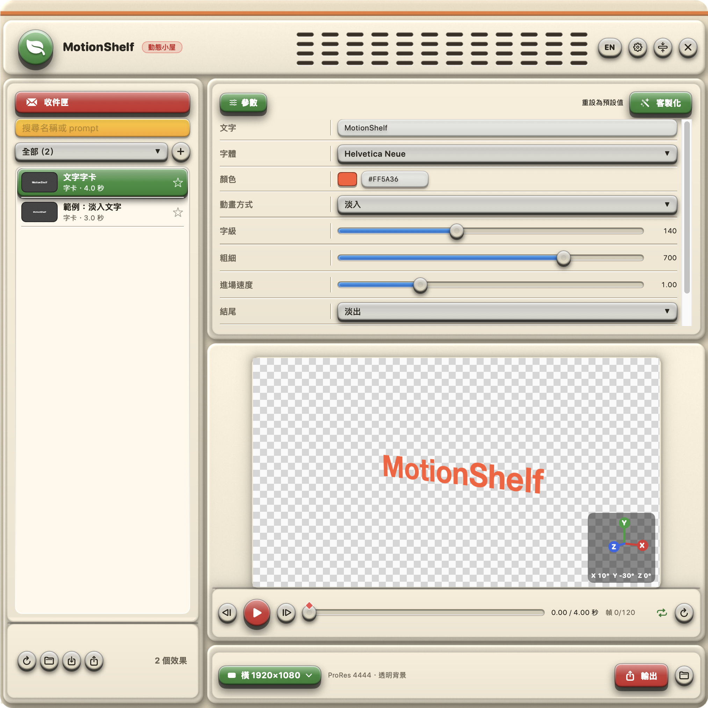

# MotionShelf 動態小屋

[English](README.md)

一個浮在 macOS 畫面上的動態效果收藏架。每個效果都是一小段可以調參數的 HTML 動畫，MotionShelf 會即時預覽，並輸出成**透明背景的 ProRes 4444**，直接拖進 DaVinci Resolve（或 Final Cut、Premiere、After Effects）的時間軸就能用。

在網路上看到喜歡的 motion prompt 就收進來，再交給 **Claude Code** 幫你做成效果。



## 功能

- **浮動面板**：按 ⌥Space 在任何 App 上叫出或隱藏，也可以縮成一條工具列。
- **播放**：點一下預覽畫面，再按**空白鍵**就能播放或暫停（在文字輸入框裡打空白照常輸入）。
- **參數**：每個效果有自己的控制項（文字、字體、顏色、拉桿、選單），預覽即時更新。
- **透明輸出**：ProRes 4444（含 alpha），解析度有 1920×1080、1080×1920、1440×1440。輸出後可以直接從 MotionShelf 拖進剪輯軟體。
- **收件匣**：貼上 motion prompt 存起來，存之前可以先請 Claude 分析裡面有幾個獨立效果。
- **統一生成**：Claude Code 在背景把收件匣每一筆做成效果、自己驗證，完成後自動出現在清單裡。對話框會顯示過程，也可以直接回覆它。
- **客製化**：在參數區請 Claude 幫目前的效果加參數或修改動作。
- **3D 攝影機**：在預覽畫面上直接拖移，就能用關鍵幀轉動、平移、推近拉遠任何效果的攝影機，還有三維座標顯示；預覽和輸出都有效，背景維持透明。需要真正的 3D 場景時，效果可以內嵌 Three.js（見下方）。
- **分類與收藏**、搜尋、右鍵移動或刪除效果，以及中文／English 切換。
- **分享效果**：把效果匯出成 `.mseffect` 檔傳給別人，對方匯入就能直接用、也能再修改，不需要重新生成。匯入前會先檢查。
- **自己接 agent**：第一次開啟時選要用的 AI（Claude Code、Codex、Gemini 或自訂指令）和模型，也可以先不用 AI。
- **資料夾自己決定**：效果、收件匣、輸出影片放哪裡都在設定裡選。

## 需要的環境

- macOS 14 以上
- Xcode 或 Xcode Command Line Tools（Swift 5.10 以上）
- 要用 AI 相關功能：在終端機登入 [Claude Code](https://claude.com/claude-code)（`claude auth login`），或接其他命令列 agent（見[連接你的 agent](#連接你的-agent)），會用到你自己方案的用量。沒有 agent 時，App 仍然可以瀏覽、預覽和輸出效果
- 要驗證效果、產生縮圖：Node.js 22 以上和 Google Chrome

## 安裝 App

```bash
git clone https://github.com/ryanchen722/motionshelf.git ~/MotionShelf
cd ~/MotionShelf
./run.sh
```

`run.sh` 會把 App 編譯到 `build/MotionShelf.app` 並打開。MotionShelf 不會出現在 Dock，按 **⌥Space** 叫出面板。App 會讀取它旁邊 `effects/` 資料夾裡的效果。

第一次開啟會跳出設定視窗：選要用的 AI 和模型、決定資料夾放哪裡（之後按右上角的齒輪可以再改）。

macOS 可能會詢問能不能取用專案所在的資料夾（例如「文件」），請允許，MotionShelf 才讀得到效果。

輸出的影片預設在 `~/Movies/MotionShelf`，可以在設定裡改。

## 安裝 Claude Code plugin

裝了 plugin，不打開 App 也能請 Claude Code 做效果：

```
/plugin marketplace add ryanchen722/motionshelf
```

```
/plugin install motionshelf@motionshelf
```

裡面有兩個 skill：

- **make-effect**：「把這段 prompt 做成 MotionShelf 效果：……」
- **process-inbox**：「處理我的 MotionShelf 收件匣」

請在 MotionShelf 資料夾裡執行 Claude Code（或把專案放在 `~/MotionShelf`），它才知道效果放在哪裡。

## 連接你的 agent

「統一生成」、「分析有幾個效果」和「客製化」會在背景執行一個 AI agent，工作目錄是專案資料夾。要用哪一個，第一次開啟時在設定視窗選（之後按齒輪），結果會存在專案資料夾的 `agent.json`，也可以自己編輯（範例見 `agent.example.json`）。沒有 `agent.json` 時用 Claude Code 和你帳號的預設模型；設成 `{ "agent": "none" }` 就是先不使用 AI。

設定視窗裡的 Codex、Gemini 是常見的指令寫法，**沒有實測過**，請對照各工具的官方文件確認。

**Claude Code**（完整支援：即時顯示過程和工具呼叫，回覆會接續同一段對話）

```json
{ "agent": "claude", "model": "opus" }
```

`model` 留空就用預設模型。

**其他命令列 agent**

```json
{ "agent": "custom", "name": "我的 agent", "command": "my-agent --some-flag {prompt}" }
```

- `{prompt}` 會換成提示詞，已經加好引號。指令用登入 shell（`zsh -lc`）在專案資料夾執行，所以 `PATH` 裡的指令都找得到。
- agent 必須能不經確認就讀寫專案資料夾裡的檔案，因為沒有人在旁邊回答它。
- 它輸出的內容會當成純文字顯示在對話框。因為沒有可以接續的對話，你回覆時 MotionShelf 會把原本的任務、到目前為止的對話和新的訊息一起再送一次。
- 非互動模式的參數請查你的 agent 的文件。例如寫這份文件時 Codex CLI 有 `codex exec`、Gemini CLI 有 `gemini -p`，這些只是範例，沒有實測過。

agent 照著做的指示是 `skills/` 裡的 Markdown，可以自己看、自己改。

## 分享與匯入效果

- **匯出**：選一個效果，按左下角的匯出按鈕（或在效果上按右鍵）。會存成 `.mseffect`，其實就是 ZIP，裡面只有 `effect.html`、`effect.json`、`source.md`、`thumb.png`。
- **匯入**：按匯入按鈕選檔案，或把 `.mseffect` 拖進視窗。匯入的效果和自己做的一樣，可以調參數、客製化、刪除。同名時可以選覆蓋或兩個都留。

效果是會執行的網頁程式碼，所以匯入前會先檢查：

1. 壓縮檔：只允許那四個檔案，擋掉路徑跳脫（`../`）、符號連結、超大檔案。
2. 格式：`effect.json` 欄位和參數正確、`effect.html` 有 `window.seek` 和 `window.setParams`、`thumb.png` 真的是 PNG，並且真的載入一次、用預設參數畫出畫面，畫不出來就拒絕匯入。
3. 內容掃描：發現連網（`fetch`、`XMLHttpRequest`、WebSocket）、`eval`、外部網址、載入外部 script、讀寫 cookie 等可疑寫法時會列出來，**由你決定要不要匯入**。

另外，預覽和輸出時 MotionShelf 會封鎖所有網路連線，效果沒辦法把資料傳出去。這些檢查能擋掉大多數問題，但**不能保證 100% 安全**，只匯入你信任的人給的效果。

## 自己做效果

一個效果就是 你選的效果資料夾（預設 `effects/`）裡的一個資料夾：

```
effects/my-effect/
  effect.html   動畫本體：提供 window.seek(t) 和 window.setParams(params)
  effect.json   名稱、分類、長度和參數
  source.md     靈感來源
  thumb.png     縮圖，由驗證腳本產生
```

完整格式寫在 [skills/make-effect/effect-format.md](skills/make-effect/effect-format.md)，`effects/title-card` 是完整的範例。驗證效果並更新縮圖：

```bash
node tools/check-effects.mjs my-effect
```

新資料夾會自動出現在 MotionShelf 裡；改過現有的效果後，按預覽下方的重新載入按鈕。

## 3D 攝影機與 Three.js

- **3D 攝影機（每個效果都能用）**：在參數面板最下面開啟「3D 攝影機」，然後直接在預覽畫面上操作：拖移＝轉動（左右拖是 Y 軸、上下拖是 X 軸）、⇧ 拖移＝畫面傾斜（Z 軸）、⌥ 拖移＝攝影機左右或上下平移、滾輪或雙指縮放＝推近拉遠、雙擊＝回正。像 After Effects，每次調整都會在目前時間點記一個**關鍵幀**（時間軸上的橘色菱形），關鍵幀之間平滑過渡，所以可以從正面開始、轉到側面、再移動到別處。預覽右下角的三維座標會顯示目前的 X／Y／Z。透視強度是面板裡的滑桿。每個效果各自記住自己的攝影機。它是對完成的畫面做透視變換，沒有真正的景深；轉動時超出畫面邊緣的部分會被切掉。
- **真正的 3D（Three.js）**：[skills/make-effect/vendor/three.min.js](skills/make-effect/vendor/three.min.js) 是 Three.js r160（MIT）。需要真正 3D 的效果要把它內嵌進自己的 `effect.html`（沒有網路可用），規則寫在 [effect-format.md](skills/make-effect/effect-format.md#3d-and-camera-moves)。可以在客製化裡請 Claude 做，例如「改成 Three.js 場景，攝影機繞著轉」。匯入檢查會略過沒被改過的這份檔案，效果其他的程式碼仍照常掃描。

## 換外觀

視窗外框是 `Support/` 裡的兩張圖（`skin.png` 有透明的洞，`skin_back.png` 墊在洞後面），由 `tools/skin/final_a.py` 畫出來（需要有 Pillow 和 NumPy 的 Python）。在那裡改顏色或裝飾，執行後把兩張 PNG 複製到 `Support/`，再跑 `./run.sh`。洞的位置要和 `Sources/MotionShelf/Views/SkinView.swift` 的 `SkinLayout` 一致。

## 注意

- 效果是用 WebKit 一幀一幀畫出來的，依賴真實時間的東西（CSS 動畫、計時器）輸出會不正確，每一幀都必須只靠 `t` 畫出來。
- 程式碼裡的註解大多是繁體中文。

## 社群

歡迎加入 [Discord](https://discord.gg/Ms6WVturY)：分享你做的效果、展示作品、提問。請先讀伺服器裡的規則。效果是會執行的網頁程式碼，只匯入你信任的人給的效果。

## 支持這個專案

MotionShelf 是免費開源的。如果它對你有幫助，歡迎到 [Ko-fi 請我喝杯咖啡](https://ko-fi.com/motionhouse)。完全自由，謝謝你！

住在台灣的朋友：因為 PayPal 不支援台灣帳戶之間的付款，Ko-fi 可能無法付款。你可以改用[街口支付轉帳](https://service.jkopay.com/r/transfer?j=Transfer:901341374)（請在手機上開啟連結）。

## 授權

[MIT](LICENSE)
